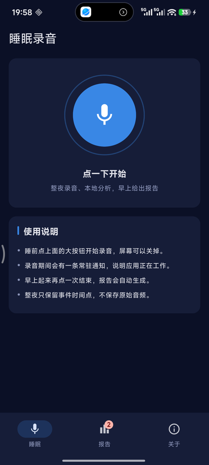
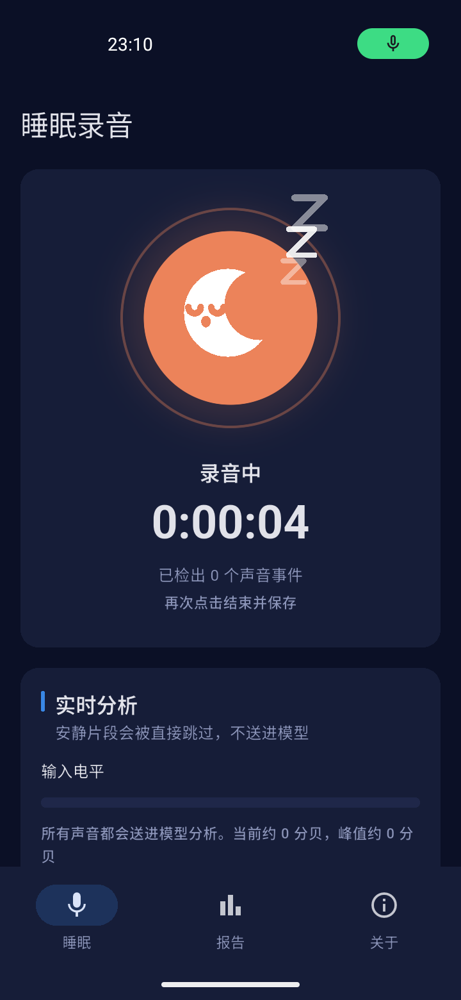
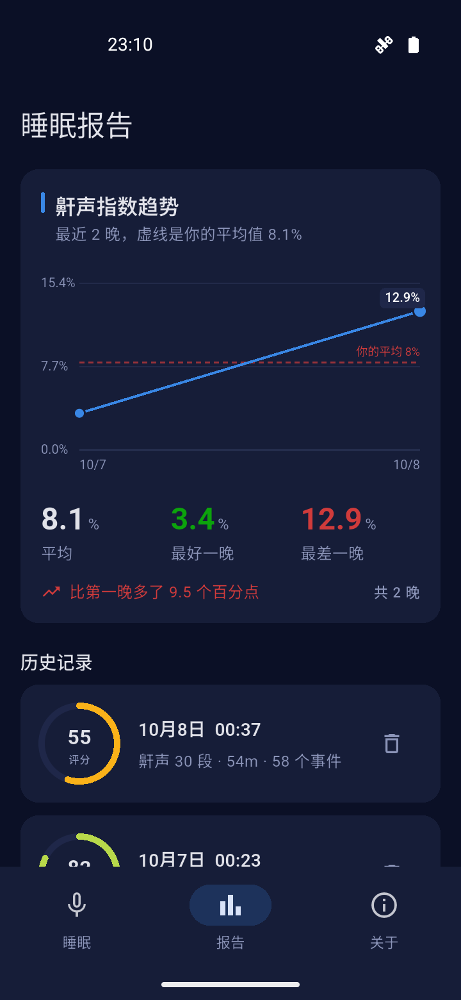
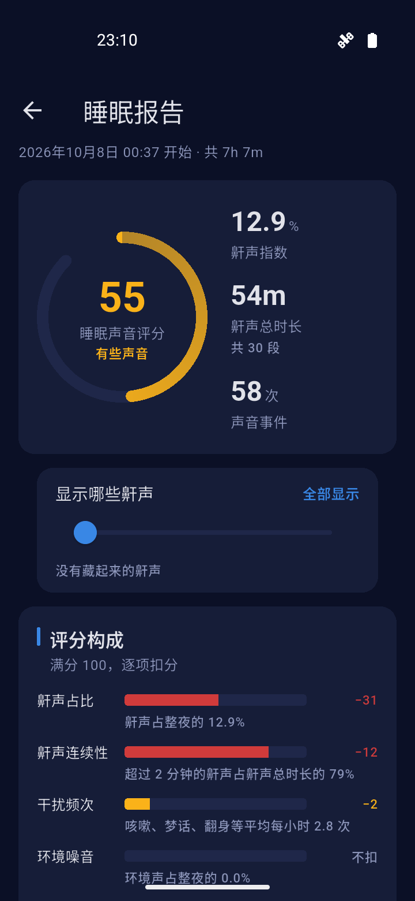
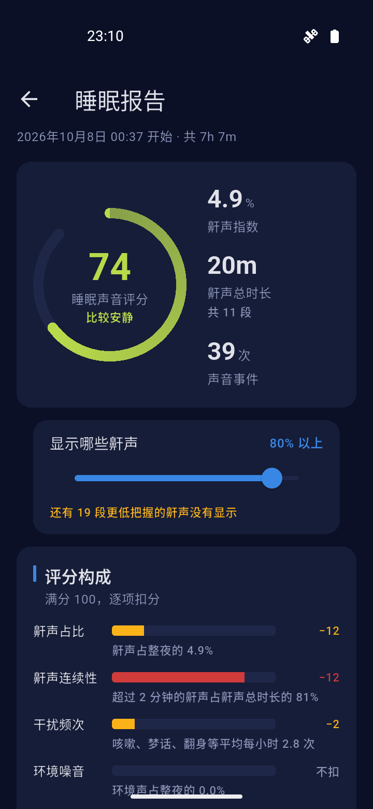
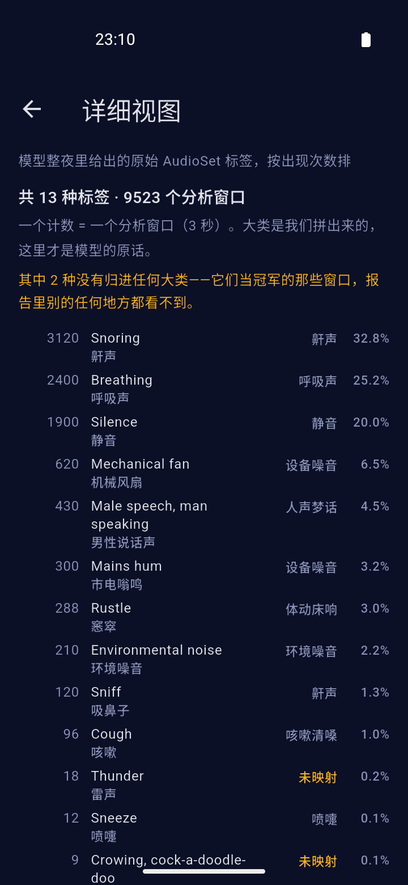
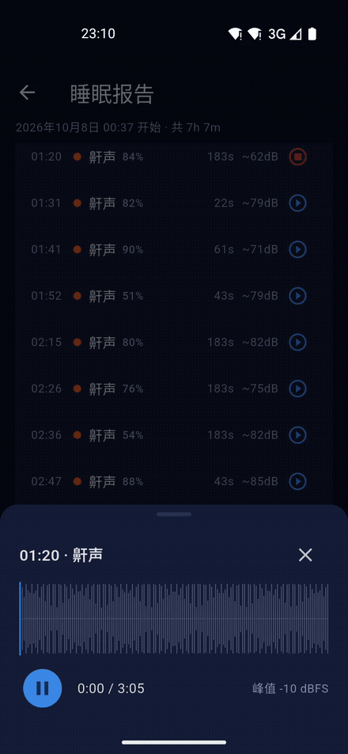

<div align="center">

# Sleep Secret

Records the night, classifies the sounds on the phone — snoring, breathing, coughing, sleep talking and more — and gives you a timeline and statistics in the morning.

**Audio stays on your device by default.** No account, no server: install it and it works, with all analysis on the phone.

The only exception is if **you** set up Nutstore / WebDAV on the export page — after that, each night's recording is uploaded to **your own** cloud storage. This project has no server of its own, and never will.

<sub>[English](README.en.md) · [中文](README.md)</sub>

<a href="https://github.com/14790897/sleep-secret/actions/workflows/ci.yml"></a> <a href="https://github.com/14790897/sleep-secret/releases"></a> <a href="https://f-droid.org/packages/com.sleepsecret.sleep_secret/"></a> <a href="LICENSE"></a>

**Docs**: <https://mygithub.sixiangjia.de/sleep-secret/en/> ([Guide](https://mygithub.sixiangjia.de/sleep-secret/en/guide/) · [Reading the report](https://mygithub.sixiangjia.de/sleep-secret/en/report/) · [Data & privacy](https://mygithub.sixiangjia.de/sleep-secret/en/privacy/))

     

<br>



<sub>Snore clips keep the <strong>whole</strong> stretch, not a snippet — open one to see the waveform, drag the playhead, and jump around</sub>

</div>

## Install

<a href="https://f-droid.org/packages/com.sleepsecret.sleep_secret/"></a>

- **F-Droid (recommended)**: <https://f-droid.org/packages/com.sleepsecret.sleep_secret/>. The F-Droid build uses the **same signing key** as the GitHub release, so you can switch between them with an in-place upgrade and keep your data. F-Droid's index updates with a delay, so its version may lag the Releases page by a few days.
- **GitHub Releases**: download the latest `app-arm64-v8a-release.apk` from [Releases](https://github.com/14790897/sleep-secret/releases) (that's the right ABI for almost every modern phone) and install it directly. It isn't on any other app store, so installing from GitHub means allowing "install unknown apps".

On first launch, grant **microphone** and **notification** permissions. On Xiaomi/Huawei-style ROMs you also need to set the battery saver to "no restrictions", allow autostart, and lock the app in the recent-apps list — otherwise the system may kill the recording overnight and you'll wake up to an empty report.

## What it does

Tap once before bed, tap again in the morning, and the report for that night **opens automatically**:

(If you tap start and immediately stop, and less than 10 seconds of audio was analysed, it asks whether to keep or delete the recording instead of silently leaving an empty night. If you deliberately recorded a short microphone test, choose "Keep".)

- **All-night sound timeline** — when there was sound, what it was, how long it lasted
- **Snore index** — snoring time as a percentage of analysed time, for comparing nights
- **Category and hourly distributions** — which hours were the loudest
- **Event details** — time, category and confidence for every event; snore (and, if enabled, sleep-talking) clips can be played back

The model's outputs are grouped into nine categories: **snoring / breathing / coughing & throat clearing / sneezing / sleep talking & voices / movement & bed noise / ambient noise / device noise / silence**.

Deliberate choices:

- **A visible level meter while recording.** The meter shows the detection threshold, so you can tell at a glance whether the microphone is working and whether the volume is high enough — the most direct way to diagnose "it recorded silence all night".
- **No post-hoc confidence gate.** Every recorded segment goes to the model and the top-scoring class wins. A "don't report anything below score X" gate sounds sensible, but in practice **it did nothing**: across rain, rooster crowing, real snoring and white noise it rejected zero windows, and even room noise was consistently (and correctly) labelled "ambient noise". The model is an end-to-end labeller; adding a threshold behind it needs real audio as evidence. Confidence is instead **shown directly in the event list**: a 0.93 snore and a 0.21 snore no longer look the same.
- **The energy gate is off by default.** Its only job is to skip quiet stretches to save compute; it wasn't catching false positives (the model does that). A threshold plus adaptive estimation plus bounds bought an estimated "~11 minutes of CPU per 8-hour night" — and that estimate was based on PC speed, not measured on a phone, so it ships off. There's a switch on the About tab ("Skip quiet stretches") with a **threshold adjustable from 30 to 60 dB**. ⚠️ Don't go by the number alone: if the phone is far away or behind a blanket, real snoring can be quieter than the default threshold — check whether the red line on the recording screen is reachable before using it overnight.
- **A snore display threshold.** A slider at the top of the report page hides snores the model wasn't confident about (0–90%; 0 shows everything). **It only affects display** — not a byte of the recording or analysis changes; hidden snores stay in the database and their clips stay on disk, and dragging back to 0 brings them all back. ⚠️ The number hidden is shown under the slider ("N lower-confidence snores are not shown"): the reason a report looks cleaner must be visible, otherwise you can't tell "a quiet night" from "filtered out". **The score and trend in the report list use the same threshold** (noted at the top of the list), so the same night can't show two different numbers. (This is not the removed confidence gate: that one **discarded windows during analysis** for everyone, rejected zero windows on real material, and was based on synthetic white noise. This one lives in the **display layer**, is off by default, and is reversible. They share only the word "confidence".)
- **Only event times are kept, not the raw audio.** A full night of 16 kHz mono is about 920 MB — storing it isn't practical. Snore clips are optional — on by default, kept **in full** (not a snippet), about 1.9 MB per minute, in the app's private directory, removed when you uninstall. Sleep-talking clips are kept by default too (speech has different privacy implications; there's a separate switch on the About tab).

## What it doesn't do

- **It is not a medical device** and cannot diagnose sleep apnoea or any other condition.
- **No sleep staging** (deep/light/REM) — that needs movement or heart rate; audio alone can't do it. The "sleep sound score" only reflects **how noisy** the night was, not sleep quality.
- **Not calibrated to you.** It uses a general-purpose audio event model; individual differences will change detection rates.

## How it works

```
microphone ──> 16 kHz PCM ──> CED-tiny inference ──> event merging ──> report
                              (on-device)           (argmax)
```

The model is [CED-tiny](https://huggingface.co/mispeech/ced-tiny) (5.5M parameters, AudioSet-pretrained), exported to ONNX and run on-device with ONNX Runtime. AudioSet has 527 classes; **47** of them are grouped semantically into the nine categories above. Labels that weren't mapped don't disappear — the report's "detailed view" lists them verbatim (which is exactly how a mapping mistake was found).

CED-tiny instead of the original paper's AST: AST is 86M parameters and can't run all night on a phone; CED-tiny is an order of magnitude smaller and can.

## Tech stack

| | |
|---|---|
| App | Flutter 3.47.6 / Dart |
| Inference | ONNX Runtime (`flutter_onnxruntime`) |
| Recording | `record` plugin, 16 kHz mono PCM |
| Keep-alive | `flutter_foreground_task`, microphone-type foreground service |
| Storage | `sqflite` (analysis results only) |
| Playback | `just_audio` (clip previews) |

Three layers: UI (MVVM + ChangeNotifier) / Data (services + repositories) / Domain. The domain layer doesn't depend on Flutter, so the analysis engine can be tested without a UI.

## Development

### Requirements

- Flutter 3.47.6 (stable)
- JDK 17
- Android SDK (compileSdk follows Flutter)

### Run

```bash
cd app
flutter pub get
flutter run -d <device>
```

### Tests

```bash
cd app
flutter analyze
flutter test                                    # 541 unit tests
flutter test integration_test/all_tests.dart -d <device>   # 28 integration tests
```

**Why integration tests use a single aggregate entry point**: `flutter test integration_test` (directory form) builds and installs a separate APK for every test file. Five files means five rounds of build → install → launch → uninstall; on GitHub-hosted emulators the second round killed the emulator and the job dragged past 13 minutes. `all_tests.dart` is a forwarding entry point: one build, one install, one launch — 63 seconds for all 28 tests locally (measured on the Android emulator; 40 seconds on Windows desktop).

**Tests that need a real microphone aren't in CI**; they live in `app/integration_test_hardware/`:

```bash
flutter test integration_test_hardware/real_recorder_flow_test.dart -d <device>
flutter test integration_test_hardware/microphone_diagnostic_test.dart -d <device>
flutter test integration_test_hardware/audio_focus_test.dart -d <device>   # capture must survive another app taking audio focus
```

In CI, all audio comes from **real recordings replayed from assets** (`WavReplayAudioCapture` injected into the `AudioCapture` interface) — no hardware, no network, deterministic timing. The only thing swapped out is the `RecordAudioCapture` glue around the `record` plugin; everything above it is real code.

### On-device model

The model file is `app/assets/models/ced-tiny.onnx`. `ml/` contains the PC reference implementation and the class mapping used to cross-check the on-device results — **both sides run the same model, so the results should agree**.

```bash
cd ml
python infer.py     # runs a synthetic night through the whole pipeline
```

### Docs site

`docs/` serves two purposes: the screenshots used by the README (`docs/screenshots/`) and the source of the docs site. It's configured in `mkdocs.yml` with mkdocs-material + mkdocs-static-i18n for Chinese/English, and published by `.github/workflows/docs.yml` on every push to main.

```bash
pip install mkdocs-material mkdocs-static-i18n
mkdocs build --strict     # what CI runs
mkdocs serve              # local preview
```

> ⚠️ English pages **must be paired one-to-one with Chinese pages**: if a file is missing from `docs/en/`, the English site **silently renders the Chinese page** at the same path — the build doesn't fail and `--strict` doesn't complain. Check with the command below; empty output means everything is paired:

```bash
diff <(cd docs && find . -name '*.md' -not -path './en/*' | sort) \
     <(cd docs/en && find . -name '*.md' | sort)
```

## Releases

[semantic-release](https://semantic-release.gitbook.io/) automates it: pushing to `main` derives the version from commit messages, generates release notes, builds the artifacts, and attaches them to a GitHub Release.

### What's in a release

| Artifact | Size | Notes |
|---|---|---|
| `app-arm64-v8a-release.apk` | ~27 MB | **the one for modern phones** |
| `app-armeabi-v7a-release.apk` | ~25 MB | older 32-bit devices |
| `app-x86_64-release.apk` | ~29 MB | emulators |
| `sleep-secret-windows-<version>.zip` | ~30 MB | **testing only**, see below |

APKs are **split per ABI** instead of shipping a universal APK: a universal build is about 68 MB, while each split is 25–29 MB. The trade-off is picking the right architecture — `arm64-v8a` covers almost every modern phone.

⚠️ **The Windows build is for development/testing.** Overnight recording **does** work, with one condition: **plugged in**.

Windows doesn't need Android's foreground service — that guards against the system killing background apps, and Windows doesn't kill running apps. The only risk is **system sleep**: on AC power most machines don't sleep by default (the dev machine measures "AC 0 seconds = never"), but that isn't guaranteed; set the power plan to "never sleep" if needed. **Turning the screen off doesn't stop recording.**

(Earlier this said "not suitable for all-night recording" — that applied Android's mechanism to Windows and was simply wrong.)

The Windows artifact is built by a separate job (Flutter desktop can't cross-compile on Linux), scheduled after the release and pinned to the tag that was just created, so the version inside matches.

```
fix:              → patch (1.0.1 → 1.0.2)
feat:             → minor (1.0.1 → 1.1.0)
BREAKING CHANGE:  → major
chore:/docs:/ci:  → no release
```

> ⚠️ If a commit message doesn't follow this convention, the pipeline **doesn't fail — it silently does nothing**.

CI has four jobs: static analysis + unit tests, integration tests on the Android emulator, integration tests on Windows desktop (that path differs materially from Android, and building without running wouldn't catch it), and the release build. They run on `ubuntu-latest`, except the Windows one, which is `windows-latest`.

### ⚠️ Signing key

`app/android/sleep-secret-release.jks` and `key.properties` next to it are **this app's identity**.

**Lose them and you can never push an update to anyone who already installed it** — everyone would have to uninstall and reinstall, wiping all sleep history. Both files are gitignored; keep a local copy and a backup in GitHub Secrets.

Changing the key means changing the app's identity, with the same cost. If you ever do, remember to update `EXPECTED_CERT_SHA256` in `.github/workflows/release.yml` — the release pipeline validates the certificate fingerprint and **fails the release on a mismatch**, so it can't ship a build nobody can install over the old one.

## Measurements

Numbers measured in real use. **Every one carries its device and conditions** — a number without conditions can't be compared:

| Metric | Value | Conditions |
|---|---|---|
| **All-night battery** | **9% over 6.5 hours** | Night of 2026-10-07, Redmi K80, screen off, all-night recording, default settings (energy gate off) |

That scales to about 14% for ten hours — **an acceptable cost per night; no charger needed**. It also confirms the foreground service survives the night (the first item that used to be under "not yet verified").

⚠️ It **can't** answer "how much did inference cost": the 9% includes the microphone, CPU and screen-off idle. So the question "should the energy gate be on, or removed?" **can't be answered** by this number — it only proves the app **survives without changing anything**.

⚠️ One device, one night. A different ROM, phone, or clip-retention setting may behave differently.

## Not yet verified

Written down so they don't get mistaken for "already verified":

- **All-night survival on more devices.** One night measured: 9% over 6.5 hours, foreground service alive (see "Measurements"). But that's one Xiaomi phone for one night — another device or ROM could differ. Xiaomi/Huawei-style ROMs still need manual setup: battery saver "no restrictions", allow autostart, lock the app in recent apps.
- **Real-world snore detection rate.** The model is very confident on the **clean, close-mic recordings** in the test set (core snore scores 0.82–0.97; rain/rooster controls 0.000). But those are close-mic. There's no data yet for a phone on the pillow, recording through a blanket. (`bandlimited_snore.wav` is built for that direction — everything below 320 Hz removed and noise added, simulating "phone not next to the pillow"; it still scores 0.87. But that's **simulated**, not real-device data.)

## License

**GPL-3.0-or-later**, full text in [LICENSE](LICENSE).

GPL rather than a permissive license because this app's central claim is "audio never leaves the device" — and that claim is only checkable if the **code is checkable**. GPL guarantees that any version anyone receives can be reviewed and improved; a closed-source fork couldn't be verified.

## Third-party assets

See [THIRD_PARTY_NOTICES.md](THIRD_PARTY_NOTICES.md). All test audio is now **CC0 (public domain)** real recordings, and the model is **Apache-2.0** — no commercial restrictions.
