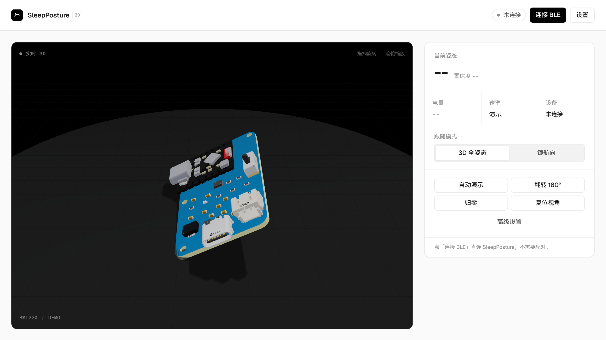
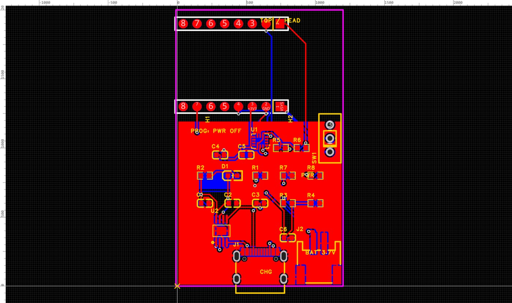
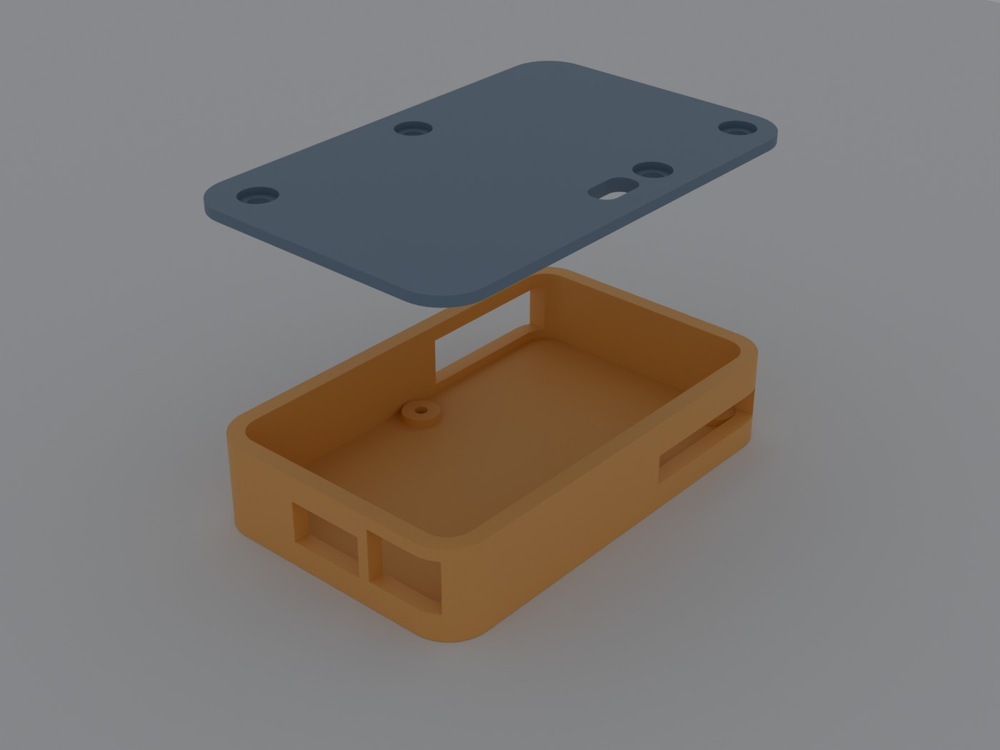

# 姿态腰带：把「怎么躺」也记下来

Sleep Secret 现在只用麦克风：它能说出一夜有多吵，但说不出你是仰卧还是侧卧。**姿态腰带 SleepPosture** 是一个配套硬件原型——一枚贴在胸骨上的 IMU，通过 BLE 把四类睡姿实时送出来。

## 为什么需要姿态

打鼾和体位有关：很多人的鼾声在仰卧时更重，侧卧会轻一些。只靠声音，报告能告诉你「这一夜很吵」，但回答不了「是不是仰卧时更吵」。把姿态时间线和声音时间线对齐，才能看出这种关系。

这不是诊断。体位性 OSA 的判断需要睡眠监测（气流、血氧、觉醒），一条腰带单独做不到。

## 硬件

| 项 | 规格 |
|---|---|
| 传感器 | 胸骨/上腹部 IMU（BMI220；BMI270、LSM6DS3TR-C 可替换） |
| 主控 | ESP32-C3 SuperMini |
| 采样与推流 | 50 Hz 采样，25 Hz BLE Notify |
| 供电 | 500 mAh 软包 + TP4056 充电 + TPS63031 稳压 |
| 载板 | 30.7 × 50.8 mm，1.0 mm 两层板，四角 M2 |
| 佩戴 | 35–40 mm 弹性胸带，元件面朝外，丝印 TOP 朝头部 |

## 姿态分类

固件在设备上做重力矢量阈值 + 迟滞状态机，输出：

- 仰卧 / 俯卧 / 左侧卧 / 右侧卧
- 翻身/过渡（moving）
- 未知（unknown）

分类依据是**躯干朝向**，不是头部朝向——头可以相对躯干转动，头带会把「侧卧但头转向天花板」判成仰卧，所以传感器放在胸骨而不是头上。

打鼾不只和躯干有关：头转向、颈部屈伸也会改变上气道。但「仰卧 / 侧卧」这个体位轴看的是躯干；头带能测转头，却测不出躯干。要同时研究两者，需要胸带 + 头部 IMU 两个传感器。

## 现在做到哪

| 模块 | 状态 |
|---|---|
| 硬件 | 首板已手工装配、上电；Gerber / BOM / CPL 可下单；充电、外壳、整夜采集未验证 |
| 固件 | 自动探测 BMI220 / BMI270 / LSM6DS3TR-C；50 Hz 采样、25 Hz BLE 稳定 |
| Web | Web Bluetooth 直连，3D 姿态实时渲染；已部署 |
| 验证 | 平放（仰卧）99%；俯卧 / 左 / 右四点、整夜尚未测试 |

> 这是个人睡眠研究原型，不是医疗器械。不要用它诊断或治疗任何疾病。

## 和 Sleep Secret 的关系

**还没接入 App。** 下一步是把腰带通过 BLE 接进来，在录音时同时记录姿态，报告里增加「体位时间线」。在接入之前，这一页和 App 里都没有姿态数据——不要把这里的原型当成已发布功能。

## 链接

- 硬件项目：<https://github.com/14790897/sleep-posture>
- 在线 3D 演示：<https://sleep-posture-3d.vercel.app>
- BLE 协议：<https://github.com/14790897/sleep-posture/blob/main/protocol/ble-protocol.md>
